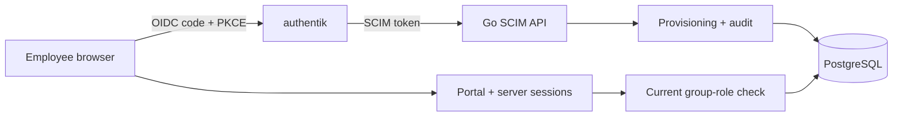
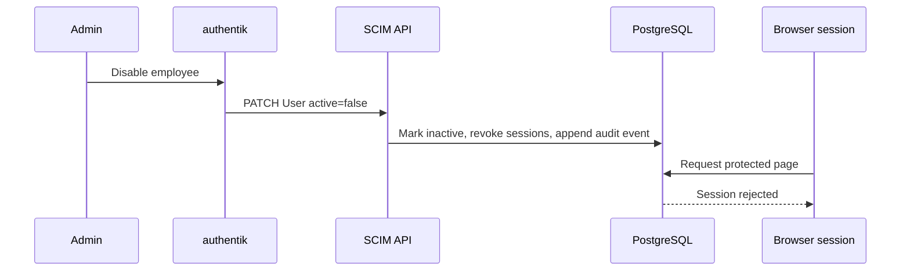

# Enterprise User Provisioning

Automatically provision, update, authorize, and deprovision SaaS users from an enterprise identity provider using SCIM 2.0 and OpenID Connect.

An employee joins a company. The identity provider provisions the SaaS account and memberships over SCIM. The employee signs in through OIDC. The application links only a pre-provisioned identity and evaluates current group-role grants on every protected request. Suspending or deleting the account revokes stored sessions.

This project implements a focused provisioning and authentication integration for local evaluation. It supports a documented SCIM subset and OIDC account linking; it does not claim full SCIM conformance or verified authentik interoperability.

## Protocols and architecture

SCIM handles lifecycle changes. OIDC handles authentication. The application decides authorization. A valid ID token alone cannot create an account or grant access.





## Quick start

Requirements: Go 1.25+, Docker Compose v2, and OpenSSL. Run the Go app on the host so the browser and backend use the same authentik issuer URL.

```sh
cp .env.example .env
cp .env.authentik.example .env.authentik
```

Replace development secrets in `.env`:

```sh
openssl rand -hex 32                    # TOKEN_HASH_SECRET
openssl rand -base64 32 | tr -d '\n='  # OIDC_CONFIG_KEY (unpadded base64)
openssl rand -base64 36 | tr -d '\n'   # PG_PASS
openssl rand -base64 60 | tr -d '\n'   # AUTHENTIK_SECRET_KEY
```

Put the generated `PG_PASS` and `AUTHENTIK_SECRET_KEY` values in both `.env` (Compose interpolation) and `.env.authentik` (passed only to authentik containers). Do not copy SaaS keys into `.env.authentik`.

Start PostgreSQL and authentik using the checked-in snapshot based on authentik 2026.8.5:

```sh
docker compose -f compose.yaml -f deployments/authentik/compose.yaml \
  up -d postgres authentik-postgresql authentik-server authentik-worker
```

Load `.env` and start the Go service on the host. Startup applies the embedded migration.

```sh
set -a; source .env; set +a
go run ./cmd/server
```

Open [authentik](http://localhost:9000) and complete its initial admin setup. In another terminal, create two tenants:

```sh
set -a; source .env; set +a
go run ./cmd/provisionctl tenant create "Northstar Analytics"
go run ./cmd/provisionctl tenant create "Harbor Systems"
go run ./cmd/provisionctl token create TENANT_UUID authentik-scim
```

The token is shown once and stored as a keyed HMAC-SHA-256 digest. See [authentik setup](docs/authentik-setup.md) for OIDC and SCIM provider configuration and explicit identity linking.

## Supported SCIM subset

All endpoints are under `/scim/v2`, require a tenant-bound bearer token, and accept bodies up to 1 MiB.

- Users and Groups: collection GET/POST; resource GET/PUT/PATCH/DELETE.
- Discovery: ServiceProviderConfig, ResourceTypes, Schemas.
- User filters: `userName`, `externalId`, `id`, `displayName`; group filters: `displayName`, `externalId`, `id`. Supported operators: `eq`, `co`, `sw`, `pr`, and `and`.
- 1-based pagination, deterministic order, maximum page size 200.
- Weak ETags and If-Match on resource mutations.
- User PATCH supports explicit paths and supported writable attributes in no-path add/replace objects; supported explicit paths include `active`, `displayName`, `department`, and `name.familyName`.
- Group PATCH supports `displayName`, `externalId`, and member add/replace/remove. Groups are flat.
- User fields include names, emails, title, userType, preferredLanguage, department, and enterprise employeeNumber, organization, division, costCenter, and manager.

SCIM value-path PATCH operations, sorting, Bulk, some optional fields, and full RFC conformance are outside the supported subset. See [SCIM support notes](docs/scim-api.md).

## Identity, authorization, and lifecycle

The CLI stores tenant-specific OIDC issuer, client ID, redirect URL, and an AES-GCM encrypted client secret. Operators explicitly link the verified issuer/subject to an existing provisioned user; email matching never creates or links accounts. The encrypted secret uses a 32-byte base64 `OIDC_CONFIG_KEY`.

Role grants require operator approval. Seed defaults with `provisionctl roles seed TENANT_UUID`; bind a stable SCIM group ID with `provisionctl roles bind TENANT_UUID GROUP_UUID ROLE_ID`. Protected handlers check current membership and permissions on every request. Default roles are `employee`, `billing_viewer`, `support_agent`, and `tenant_admin`.

`active=false` keeps the SCIM record but revokes its sessions. Reactivation does not restore old sessions. SCIM DELETE tombstones the user, removes memberships, and revokes sessions transactionally. Username may be reused after deletion.

## CLI

The CLI supports tenant create/list; token create/list/revoke/rotate; OIDC provider configuration; explicit identity linking; user/group listing; role seeding/list/bind/unbind; audit listing; and a SCIM lifecycle fixture demo. Administrative commands use direct database access and are intended for a trusted operator.

Run the fixture after starting the server:

```sh
make demo DEMO_TENANT_ID=TENANT_UUID
```

It exercises create, group assignment, department update, membership removal, suspend, reactivate, and delete through the real SCIM HTTP API. It does not perform OIDC login or claim the live authentik demo has passed.

## Verification

```sh
go test ./...
go test -race ./...
go vet ./...
go build ./cmd/server ./cmd/provisionctl
```

CI supplies PostgreSQL 16 and runs database-backed tests. The authentik setup guide describes a local integration path; deployments should validate interoperability with their configured authentik version and mappings.

The project does not include a browser-based administration dashboard or an automated OIDC end-to-end test suite. Its SCIM implementation covers a documented subset rather than the full protocol. See [tenant isolation](docs/tenant-isolation.md), [lifecycle policy](docs/lifecycle-policy.md), and the [threat model](docs/threat-model.md) for scope and security limitations.

See [CONTRIBUTING.md](CONTRIBUTING.md). Licensed under the [MIT License](LICENSE).
