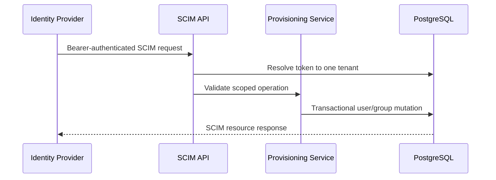

# Architecture

The service is a Go modular monolith with a SCIM HTTP handler, a pgx connection pool, and PostgreSQL persistence. Provisioning bearer credentials resolve to one tenant before a SCIM operation is handled. The database schema uses tenant-aware foreign keys for user/group memberships. User deletion is represented by a tombstone timestamp.

SCIM and OIDC have separate responsibilities. SCIM provisions identity records; OIDC authenticates a person and links the verified issuer/subject to an existing provisioned record. The app stores only hashed opaque sessions and checks current account state and group-role grants on protected requests.

